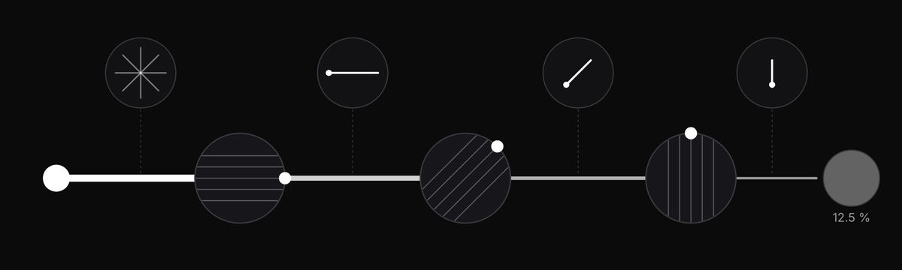

# Optics visualizations

Lukas Schreyögg · Physics B.Sc., TU Munich

I am taking Experimental Physics 3 at TU Munich this semester, which is mostly optics. I wanted to see what the formulas from the lecture actually do, so I build one small interactive page per effect: a scene you can move yourself, the model behind it, and a check of the numerics against an exact result. The pages follow the course, starting with scattering in the atmosphere, reflection at glass and polarisers.

**Try it:** https://lukasschreyoegg.github.io/optics-visualizations/

## Rayleigh scattering

**Open it:** https://lukasschreyoegg.github.io/optics-visualizations/rayleigh-scattering/

Why is the sky blue and the setting sun red? You drag the sun along its path around the Earth and follow its light down to a person. On the way the air scatters light out of the beam, mostly blue, and that scattered blue is the sky. The lower the sun, the longer the path through the air, and at sunset almost all of the blue is gone before the light arrives.

### How it works

Air molecules are much smaller than the wavelength, so the light makes their electrons oscillate like small dipoles far below their resonance in the UV. A dipole radiates with ω⁴, which is why blue light is scattered about six times more strongly than red light. I did not want to guess the resonance frequency, so the cross section comes from the measured refractive index of air: `σ(λ) = 24π³/(λ⁴N²) · ((n²−1)/(n²+2))² · F_K`.

The atmosphere is an isothermal layer with scale height `H = k_B·T/(m·g) ≈ 8.4 km` around a round Earth. Along every light path the optical depth `τ = σ·∫N ds` is integrated numerically, and the light that is left is `e^(−τ)`. The sky colour is single scattering of sunlight towards the person, including the Earth's shadow after sunset. An ozone layer at 22 km absorbs in the Chappuis band, which keeps the twilight sky blue instead of grey. A cloud layer can be switched on: its droplets are much larger than the wavelength and scatter all colours alike, so the cloud is white from above and grey from below. Spectra are turned into colours with the CIE 1931 colour-matching functions.

### Does it give the right numbers?

- Air mass with the sun at the zenith: 0.9998 (exact: 1)
- Air mass with the sun at 60°: 1.1540 (flat atmosphere `1/sin h` = 1.1547; the small difference is the Earth's curvature)
- Air mass with the sun on the horizon: 34.46 (`√(πR/2H)` = 34.45)
- Ozone column overhead: 300.0 DU (input: 300 DU)
- Rayleigh optical depth at 550 nm: 0.097 (literature value 0.097, Bodhaine et al. 1999)
- Exponent of σ(λ) between 450 and 700 nm: −4.08 instead of −4, because the UV resonance is not infinitely far away

### Limitations

Single scattering only, no aerosols (so the setting sun gets orange, not deep red), no refraction, Chappuis band as a Gaussian (about ±30 %), cloud as a two-stream approximation (about ±10–20 %), heights in the drawing hugely exaggerated.

## Fresnel equations and the Brewster angle

**Open it:** https://lukasschreyoegg.github.io/optics-visualizations/fresnel-brewster/

You drag a lamp around a point on a glass surface and watch how much light is reflected and how much goes into the glass, separately for TE light (field perpendicular to the plane of incidence) and TM light (field in that plane). At one angle the reflected TM light disappears completely, and from inside the glass, above a certain angle, everything is reflected.

### How it works

Snell's law gives the direction of the refracted ray, and the Fresnel equations give the amplitudes of the reflected and the transmitted wave for TE and TM. The reflected power is `R = |r|²`, the transmitted power `T = (n₂·cos θ_t)/(n₁·cos θ_i) · |t|²`, and the thickness of each ray in the picture is proportional to its power. For TM light the electrons in the glass oscillate perpendicular to the refracted ray, and an oscillating dipole emits nothing along its axis. At the Brewster angle the reflected ray would run exactly along that axis. This happens when `θ_i + θ_t = 90°`, which gives `tan θ_B = n₂/n₁`. Coming from inside the glass, `sin θ_t` would have to exceed 1 above `sin θ_c = n₂/n₁`; then all light is reflected, and only an evanescent wave reaches a few hundred nanometres into the air, with depth `d = λ/(2π·√(n₁² sin²θ_i − n₂²))`.

### Does it give the right numbers?

For air and glass (n = 1.5):

- Brewster angle, numerical minimum of R_TM: 56.310° (`arctan(n₂/n₁)` = 56.310°)
- Critical angle from inside the glass, onset of R = 1: 41.810° (`arcsin(n₂/n₁)` = 41.810°)
- Reflection at normal incidence: 0.0400 (`((n₁−n₂)/(n₁+n₂))²` = 0.04)
- R + T = 1 for TE and TM at every angle, with T computed from its own formula for t

### Limitations

Real refractive indices only (no absorption), no dispersion, the phase jump on reflection is not shown, no multiple reflections in a plate; the sign convention for r_TM differs between textbooks, but R does not depend on it.

## Polarisers and Malus' law

**Open it:** https://lukasschreyoegg.github.io/optics-visualizations/polarization/

Unpolarised light from a lamp passes up to three polarisers, which you can switch on and off and turn with a slider each. Small windows above the beam show how the electric field oscillates between them. The classic surprise: two crossed polarisers block everything, but a third one in between at 45° lets light through again.

### How it works

The field is a two-dimensional vector, and each polariser projects it onto its transmission axis. Because the intensity goes with the square of the field, every polariser multiplies the intensity by `cos²Δ`, where Δ is the angle between the light and its axis (Malus' law). Unpolarised light oscillates in all directions at random, so the first polariser passes the average of `cos²`, which is one half. For three polarisers at 0°, 45° and 90° this gives `I = I₀/2 · cos²45° · cos²45° = I₀/8`.

### Does it give the right numbers?

- Average of cos² over all directions, numerically: 0.500000 (exact: 1/2)
- Malus, polarisers at 0° and 60°: 0.125 I₀ (`I₀/2 · cos²60°` = 0.125 I₀)
- Crossed polarisers: 0 (exact: 0)
- Three polarisers at 0°, 45° and 90°: 0.125 I₀ (`I₀/8`)
- 3000 random settings: the step-by-step vector projection agrees with the cos² formula to machine precision, and no polariser ever lets out more light than goes in

### Limitations

Ideal polarisers (no leakage, no absorption along the axis), no reflections at their surfaces, linear polarisation only.

## Running it

Open `index.html` in any browser. Every page is a single HTML file with plain JavaScript, no build step and no libraries.

## How it was made

I built this together with Claude (Anthropic) as a coding assistant. The idea, the choice of what to show and the physics checks are mine. Most of the JavaScript was written by Claude.
